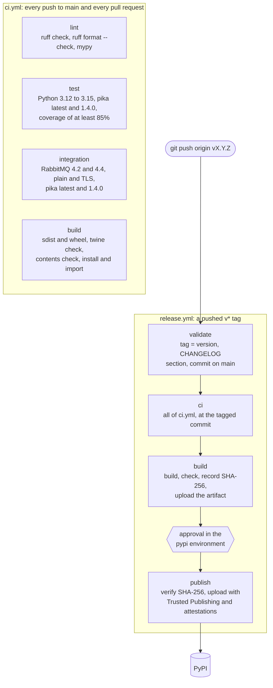

# CI/CD and releasing pykicak

pykicak is tested by GitHub Actions on every push and pull request, and published to PyPI by
GitHub Actions only, when a version tag is pushed and a maintainer approves it. Nobody uploads from
a laptop, and no PyPI password or API token is stored anywhere.

## How it fits together



### `ci.yml`: continuous integration

Runs on every push to `main`, on every pull request, and as the first stage of a release.

| Job | What it checks |
| --- | --- |
| `lint` | `ruff check .`, `ruff format --check .`, and `mypy` (strict, over `pykicak`, `examples`, `tests`, and `.github/scripts`) |
| `test` | The unit tests on Python 3.12, 3.13, 3.14, and 3.15 with the newest pika, and on 3.12 with pika 1.4.0, the oldest `pyproject.toml` allows. Statement coverage of `pykicak` must be at least 85% (`fail_under` in `pyproject.toml`; the unit tests reach about 99%) |
| `integration` | The integration tests against RabbitMQ 4.2 and 4.4, each with a plain and a TLS listener, with the newest pika and with pika 1.4.0: four required jobs. The two broker versions take a delivery that outlasts its consumer timeout back in different ways, and both are tested |
| `build` | Builds the sdist and the wheel, runs `twine check --strict`, checks with `.github/scripts/release_checks.py dist` that both hold the package version and nothing but the package, and imports the wheel from a fresh environment |

### `release.yml`: continuous delivery

Runs only when a tag matching `v*` is pushed. Pushes to branches and pull requests never publish.

1. **validate** checks, with `.github/scripts/release_checks.py tag`, that the tag is `v` followed
   by `__version__` of `pykicak/__init__.py`, that the version is `X.Y.Z` (or a pre-release such as
   `X.Y.Zrc1`), and that `CHANGELOG.md` has a `## [X.Y.Z] - YYYY-MM-DD` section. It also checks that
   the tagged commit is on `main`.
2. **ci** runs all of `ci.yml` at the tagged commit. Any failure stops the release.
3. **build** builds the distributions once, checks them like CI does, records their SHA-256
   digests, and uploads them as the workflow artifact `dist`.
4. **publish** waits for a reviewer to approve the deployment to the `pypi` environment. Then it
   downloads the artifact, checks that the files are exactly the ones the build job recorded, and
   uploads them with [`pypa/gh-action-pypi-publish`](https://github.com/pypa/gh-action-pypi-publish).

### Security properties

- **No long-lived credentials.** PyPI [Trusted Publishing](https://docs.pypi.org/trusted-publishers/)
  exchanges the publish job's short-lived OpenID Connect token for an upload token that expires
  within minutes. Only the publish job has `id-token: write`; every other job can only read the
  repository, and no job has a write permission.
- **Human approval.** The `pypi` environment requires a reviewer to approve each release, and only
  `v*` tags may deploy to it.
- **Exact artifacts.** The files uploaded are the ones built and checked in the same run: the
  publish job compares their SHA-256 digests with the build job's record, and
  `actions/download-artifact` checks the artifact's own digest.
- **Attestations.** Each file is uploaded with a [PEP 740](https://peps.python.org/pep-0740/)
  attestation, a Sigstore signature tying it to this repository, `release.yml`, and the commit.
  PyPI shows it on the file's page.
- **Pinned dependencies.** Every action is pinned to the full commit SHA of a release, with the
  release in a comment beside it, so a moved tag cannot change what runs. The development tools are
  pinned in `[dependency-groups]` of `pyproject.toml`, and pip through setup-python's
  `pip-version`. Checkouts keep no credentials (`persist-credentials: false`).
- **Reviewed updates.** Dependabot (`.github/dependabot.yml`) proposes updates of the actions and the
  pinned tools weekly, as pull requests that CI tests. A 7-day cooldown leaves a new release time to
  be found broken or compromised before it is proposed; security updates are proposed at once.
  Dependabot cannot update the pip version in the workflows: raise `pip-version` by hand now and
  then.

## One-time setup

These are done once, in the GitHub and PyPI web interfaces. The first two are already done for
pykicak; the steps are here to recreate or check them.

### GitHub: the `pypi` environment

1. In the repository, open **Settings → Environments → New environment**, name it `pypi`
   exactly, as `release.yml` refers to it by that name.
2. Under **Deployment protection rules**, check **Required reviewers** and add the maintainers who
   may approve releases. With a single maintainer, leave **Prevent self-review** unchecked, or no
   one can approve.
3. Under **Deployment branches and tags**, choose **Selected branches and tags**, and add a rule of
   type **Tag** with the pattern `v*`. No branch can then deploy to the environment.
4. Add no secrets: Trusted Publishing needs none.

### PyPI: the trusted publisher

1. On [pypi.org](https://pypi.org/), open **Your projects → pykicak → Manage → Publishing**.
2. Under **Add a new publisher**, choose **GitHub** and enter:

   | Field | Value |
   | --- | --- |
   | Owner | `przemek-barczak` |
   | Repository name | `pykicak` |
   | Workflow name | `release.yml` |
   | Environment name | `pypi` |

3. Once a release has been published this way, delete any API token for pykicak from
   **Account settings → API tokens**, and from `~/.pypirc` on any machine that has one. Nothing
   needs them any more.

Renaming `release.yml` or the environment breaks publishing until the trusted publisher is updated
to match.

### Recommended repository settings

- **Settings → Rules → Rulesets → New tag ruleset**: target `v*`, and restrict deletions and
  updates, so that a released tag can never be moved to another commit. Restrict creations too if
  others have write access.
- **Settings → Rules → Rulesets → New branch ruleset** for `main`: require pull requests and the CI
  status checks before merging.
- **Settings → Actions → General**: keep **Workflow permissions** at **Read repository contents and
  packages permissions**, and consider **Require actions to be pinned to a full-length commit
  SHA**.
- **Settings → Advanced Security**: enable **Dependabot alerts** and **Dependabot security
  updates**. Version updates need nothing more than `.github/dependabot.yml`.

## Releasing a version

1. **Prepare the release** on `main`, through a pull request or directly:
   - Set `__version__` in `pykicak/__init__.py`, the only place the version is set.
   - In `CHANGELOG.md`, rename `## [Unreleased]` to `## [X.Y.Z] - YYYY-MM-DD`, add a new empty
     `## [Unreleased]` above it, and update the comparison links at the bottom.
   - Commit, for example `chore: release X.Y.Z`, push, and wait for CI to pass on `main`.
2. **Check the tag** you are about to push, from an up-to-date `main`:

   ```bash
   python .github/scripts/release_checks.py tag vX.Y.Z
   ```

3. **Tag the commit and push the tag:**

   ```bash
   git tag -a vX.Y.Z -m "pykicak X.Y.Z"
   git push origin vX.Y.Z
   ```

4. **Approve the deployment.** In **Actions → Release**, open the run. Once validate, CI, and build
   have passed, the publish job waits; choose **Review deployments**, check `pypi`, and approve.
   Approval is the last chance to stop: reject it, and nothing is published.
5. **Check the result:** the version on <https://pypi.org/project/pykicak/>, an attestation on each
   of its files, and `pip install pykicak==X.Y.Z` in a fresh environment. Optionally, create a
   GitHub release from the tag with the changelog section as its notes.

A pre-release works the same way: version `X.Y.Zrc1`, tag `vX.Y.Zrc1`, and a changelog section
`## [X.Y.Zrc1] - YYYY-MM-DD`. pip installs a pre-release only when asked to (`--pre`, or the exact
version).

## When a release fails

Files on PyPI cannot be replaced: once a file of a version is uploaded, that version can never be
uploaded with other contents, not even after deleting it. Recovery therefore depends on whether
anything reached PyPI.

### Nothing was published

If validate, CI, or build failed, or the deployment was rejected, PyPI is untouched.

- **A temporary failure** (a runner, network, or broker hiccup): in the run, choose **Re-run failed
  jobs**.
- **The tag does not match the version, or the changelog lacks the section:** fix it on `main`
  (or tag the right commit), and move the tag.
- **A real failure:** fix it on `main` through the usual process, then move the tag to the fixed
  commit.

Moving the tag is safe only while nothing is published:

```bash
git push --delete origin vX.Y.Z
git tag -d vX.Y.Z
git checkout main && git pull
git tag -a vX.Y.Z -m "pykicak X.Y.Z"
git push origin vX.Y.Z
```

A tag ruleset that restricts deletions (above) must be bypassed, or relaxed briefly, to do this.

### The publish job failed

- **PyPI refused the token** (for example `invalid-publisher`): the trusted publisher does not match
  the repository, the workflow file name, or the environment name. Correct it on PyPI, then choose
  **Re-run failed jobs**.
- **Only some files were uploaded:** choose **Re-run failed jobs**. It reuses the build job's
  artifact, and PyPI accepts a file it already has with the same contents, so the run completes the
  release. Never choose **Re-run all jobs** here: it builds new files, whose contents differ, and
  PyPI refuses them for the file names it already has.

Each re-run of the publish job needs the deployment approved again. The artifact is kept for 30
days.

### A broken version was published

A published version cannot be fixed in place:

1. **Yank it** on PyPI (**Manage → Releases → Options → Yank**), with the reason. pip then no longer
   picks it, unless someone asks for exactly that version.
2. Fix the problem on `main`, and release the next patch version, `X.Y.(Z+1)`, with a changelog
   entry that names the yanked version.

Deleting a release instead of yanking it does not free its version number, and it breaks anyone
who pinned it. Delete only something that must not be downloaded at all, such as a leaked secret.
